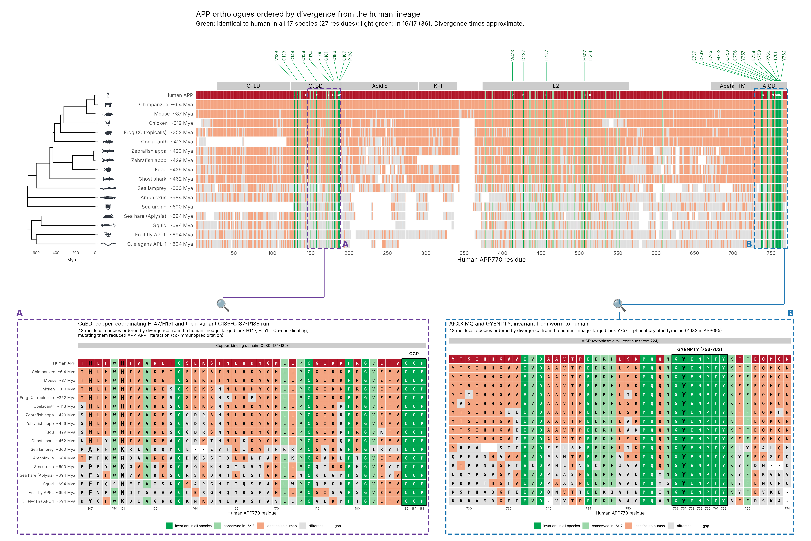

# APP family evolution: orthologues, paralogues and conserved residues

Comparative analysis of the amyloid precursor protein (APP) family from *C. elegans* APL-1 to human APP, including the vertebrate paralogues APLP1 and APLP2.



## Sequences

29 UniProt entries (`analysis/verified.fasta`). Every sequence was checked against UniProt's CRC64 checksum and length (`analysis/parse.py`).

| Group | Species |
|---|---|
| APP orthologues (17) | human, chimpanzee, mouse, chicken, *Xenopus tropicalis*, coelacanth, zebrafish appa/appb, fugu, ghost shark, sea lamprey; APP-like in amphioxus, sea urchin, *Aplysia*, squid, *Drosophila* (APPL), *C. elegans* (APL-1) |
| APLP1 (5) | human, mouse, *Xenopus*, zebrafish, coelacanth |
| APLP2 (7) | human, mouse, chicken, *Xenopus*, zebrafish, coelacanth, ghost shark |

Some unreviewed entries are fragments or contain likely gene-model artefacts. Coelacanth APP H2ZW72 and chicken APP A0A8V0Y745 are N-terminally truncated, and the chicken entry also has an internal insertion.

## Methods

- **Alignment:** MAFFT L-INS-i (`--localpair --maxiterate 1000`)
  - all 29 sequences → `all_aln.fasta`
  - the 17 APP orthologues → `app_aln.fasta`
- **Tree:** IQ-TREE 2, LG+G4, 1000 ultrafast bootstraps (`tree.contree`). Rooted on the protostome APP-like proteins.
- **Conservation:** each orthologue is compared to human APP770 at every human residue. "Invariant" means identical in all 17 APP orthologues.
- **Divergence times:** approximate published estimates of when each lineage split from ours, used only to order the rows.

## Key results

- **Invariant residues:** 27 human APP residues are identical in all 17 orthologues. They cluster in:
  - the copper-binding domain cysteines and the C186–C187–P188 run
  - the E2 domain (W413, D427 and the metal-binding H457/H507/H514)
  - the cytoplasmic tail: M752–Q753 and the full **GYENPTY** motif (756–762)
- **GYENPTY:** also identical in every APLP1 and APLP2 sequence, i.e. all 29 proteins. Y757 (Y682 in APP695) is the phosphorylated tyrosine.
- **Aβ1–42:** conserved across jawed vertebrates (83–100% identity to human). It is absent from APLP1, APLP2 and the invertebrate APP-like proteins. Mouse differs from human at R5G, Y10F and H13R.

## Figures

| File | Content |
|---|---|
| `fig1_tree.png` | ML tree of the APP family |
| `fig2_conservation.png` | Rolling identity to human along APP770 |
| `fig3_abeta_alignment.png` | Aβ region across all 29 sequences |
| `fig4_abeta_logo.png` | Aβ1–42 sequence logo, vertebrate APP |
| `fig5_conservation_map.png` | Full-length orthologue map, species ordered by divergence |
| `zoomB_CCP.png`, `zoomF_GYENPTY.png` | 43-residue zooms on contiguous invariant runs |
| `zoomAbeta.png` | Abeta1-42 (APP770 672-713) across the 17 orthologues |
| `fig7_overview_with_zooms.png` | Composite of the map and both zooms |

## Reproduce

All of these steps run from `analysis/`.

**Requirements:**
- R ≥ 4.3 with Biostrings, ggplot2, ape, ggseqlogo, ggrepel, patchwork, ragg and png
- MAFFT and IQ-TREE 2
- Python 3 with Biopython and Pillow

**Commands:**
```bash
python3 parse.py                       # verify sequences -> verified.fasta
mafft --localpair --maxiterate 1000 verified.fasta > all_aln.fasta
mafft --localpair --maxiterate 1000 app_only.fasta > app_aln.fasta
iqtree2 -s all_aln.fasta -m LG+G4 -B 1000 -T AUTO --prefix tree
Rscript analysis.R                     # fig1-4 + conservation CSV
Rscript zooms.R                        # fig5 + zoom panels (sources fig5.R)
python3 draw_icons_svg.py              # organism silhouettes (vector)
python3 compose.py                     # fig7 composite
```

Organism silhouettes are hand-drawn vectors (`draw_icons_svg.py`, SVG + PNG in `icons_sci/`). The species tree in the alignment figures (`species_tree.R`) uses the accepted metazoan topology with approximate node ages; zebrafish appa/appb are drawn as a short paralogue fork.

## NPxY motifs in human LRP-family receptors (`lrp_npxy/`)

The cytoplasmic tails of 13 human receptors are compared with each other, not across species: LRP1, LRP1B, LRP2, LRP3, LRP4, LRP5, LRP6, LRP8, LRP10, LRP11, LRP12, VLDLR and SORL1. All sequences were checksum-verified against UniProt.

**Method:** windows of ±10 residues are anchored on each NPxY that lies after the annotated transmembrane helix. Each motif is compared with LRP1 NPxY1 (N4470PTY) in `figures/fig8a_LRP_NPxY_ref_LRP1-NPxY1.png` and with LRP1 NPxY2 (N4504PVY) in `figures/fig8b_LRP_NPxY_ref_LRP1-NPxY2.png`. For the two-motif receptors (LRP1B, LRP2), each figure shows only the motif that corresponds to the reference; the single-motif receptors (LRP4, LRP8, VLDLR) appear in both.

**Receptors with NPxY:**
- **Two motifs each:** LRP1, LRP1B and LRP2. The second, distal motif in all three is NPVY/NPIY preceded by N-F/N-x (an FxNPxY-like context).
- **One membrane-proximal motif:** LRP4, LRP8 and VLDLR. LRP8 and VLDLR share an identical FDNPVY.

**Receptors without NPxY:** LRP3, LRP5, LRP6, LRP10, LRP11, LRP12 and SORL1.

```bash
cd integrin_npxy && Rscript npxy_plots.R   # builds fig8a, fig8b and fig9
```

## NPxY motifs in human integrins (`integrin_npxy/`)

All 26 reviewed human integrin subunits (18 α, 8 β) were scanned for NPxY after the annotated transmembrane helix. The 8 β sequences are checksum-verified. For the α subunits, only the GFFKR-anchored cytoplasmic tails were scanned.

**Integrins with NPxY:**
- **ITGB1:** two motifs, N780PIY and N792PKY.
- **ITGB3, ITGB5, ITGB6, ITGB7:** one membrane-proximal NPLY each, all 29 residues after the transmembrane helix.

**Integrins without NPxY:** ITGB2 (it has NPLF/NPKF instead), ITGB4, ITGB8 and all α subunits.

These motifs are compared with APP's NPTY (N759) in `figures/fig9_integrin_NPxY_ref_APP.png`.
